#  SSHub

[](https://crates.io/crates/sshub)
[](https://crates.io/crates/sshub)
[](https://www.npmjs.com/package/sshub-tui)
[](https://www.npmjs.com/package/sshub-tui)
[](#model-credits)
[](https://sshub.petruha.uk)

A terminal UI for managing and connecting to SSH hosts. Combines your `~/.ssh/config` with a built-in host database, tunnels, key management, and an audit log -- all in one keyboard-driven interface.

> ⚠️ This project is ~98.5% vibe-coded slop — see [Model credits](#model-credits) for the ever-growing pack of LLMs responsible — the other ~1.5% is real humans (see Contributors). It has — and will keep having — stupid bugs LLMs can't see. Use at your own risk.

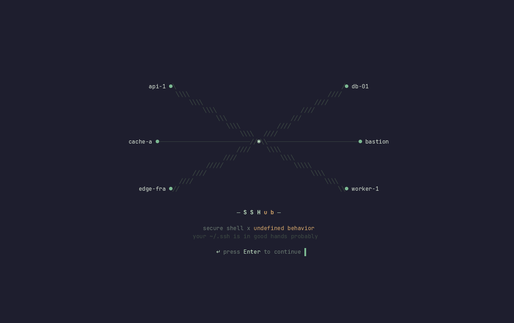

Navigating the dashboard: nested host groups, the fuzzy palette (`/`), the group manager (`Shift+G`), and the multi-tag filter (`#`):


Connecting to a host: the session runs in an embedded PTY right inside the TUI. `Ctrl+D` detaches, `Ctrl+T` opens a second session tab, and `Alt+S` finds a running session by name:


Inside a session: a command you ran comes back as a dim inline suggestion (`Tab` takes it), and `Ctrl+N` opens the snippet library (`Enter` runs a snippet, `Tab` types it for editing first):

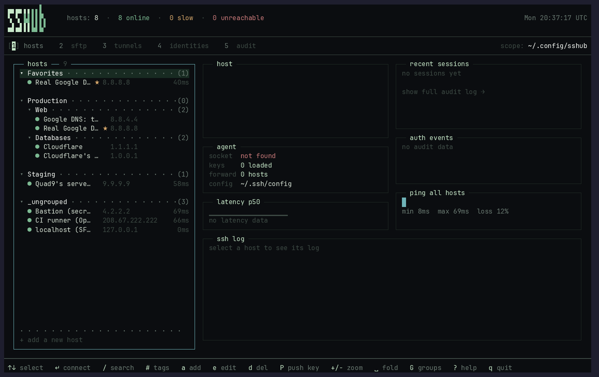

Adding a managed host: address, password, username, label, two groups and tags, saved with `Ctrl+S`:


Transferring files over SFTP: a dual-pane browser (local / remote) with a staged transfer queue, plus chmod, new folder and delete in place:

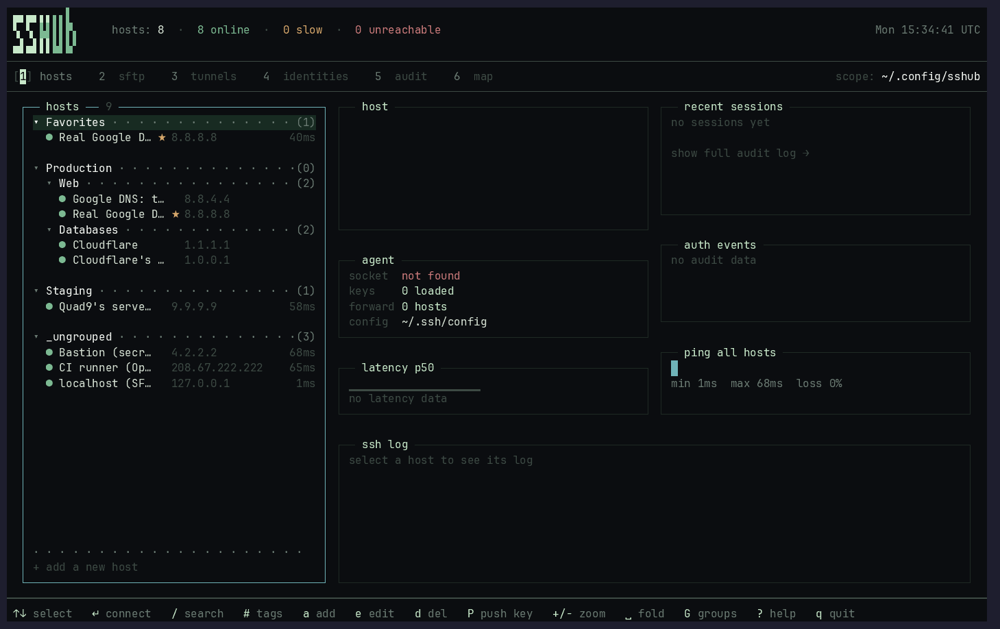

Broadcast (`b`): one command on every host of a group or tag, with a preview of the hosts before it runs and a live results panel:


Themes: Settings (`Ctrl+H`), then `Theme...`. Every step in the picker previews that theme on the whole interface; `Enter` keeps it, `Esc` puts the old one back:


## Screenshots

The hosts dashboard: nested groups on the left; the selected host's card shows its auto-detected OS logo, fact sheet, and per-host latency, with live agent / ping panels alongside:

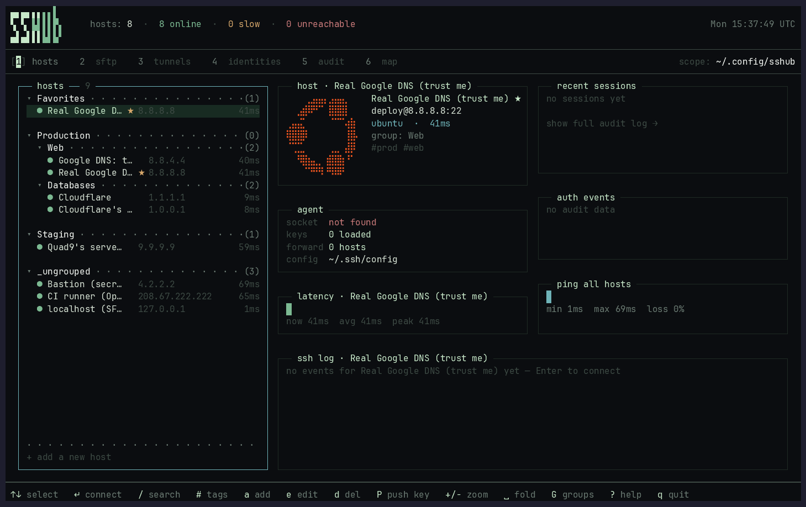

Fuzzy quick-connect palette (`/`) and the multi-tag filter (`#`):

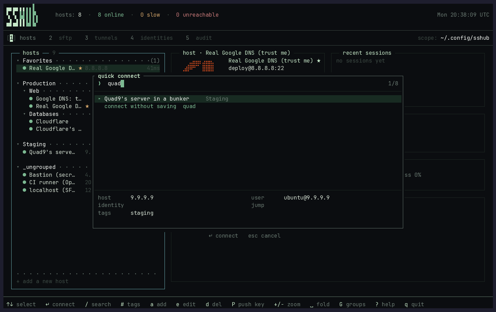
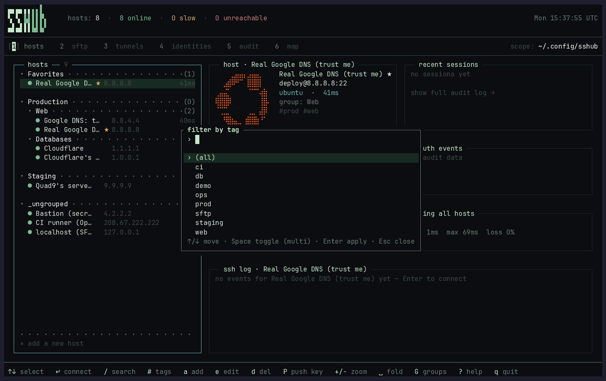

Add/edit host form, the rebindable keybindings editor (`Ctrl+K`), and the scrollable help overlay (`?`):

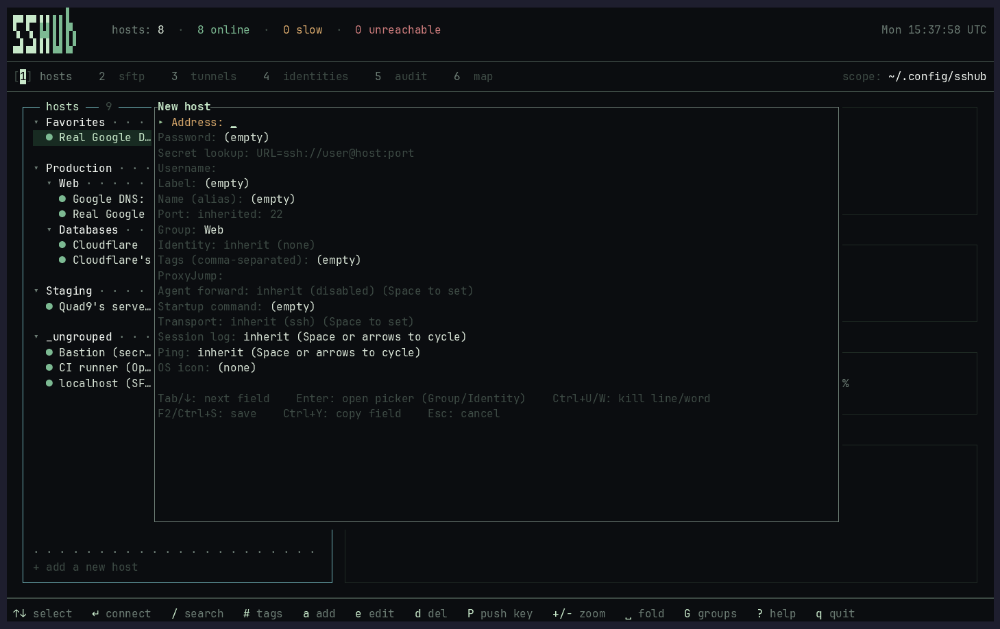
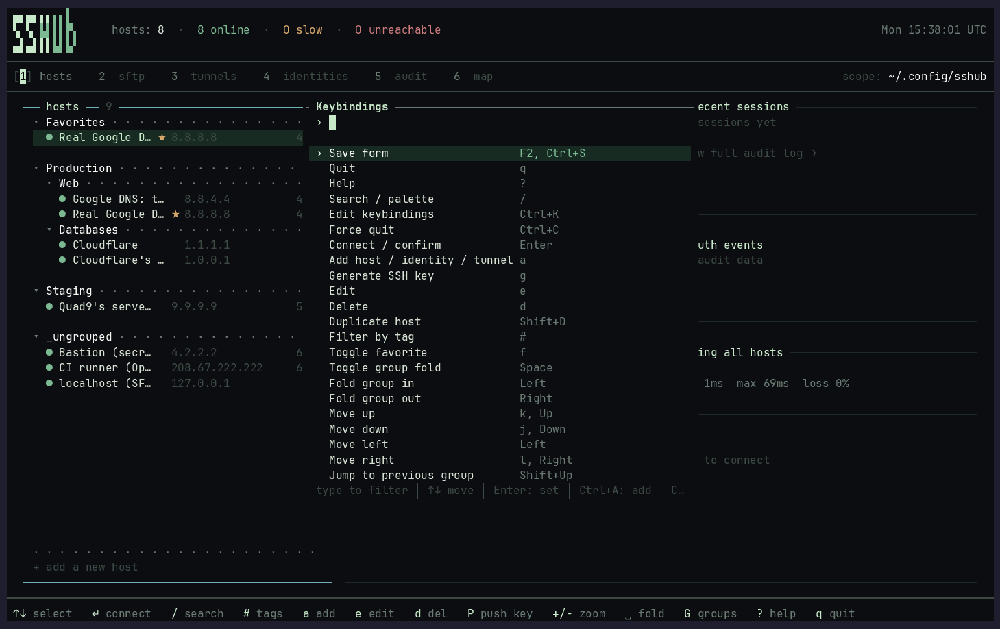
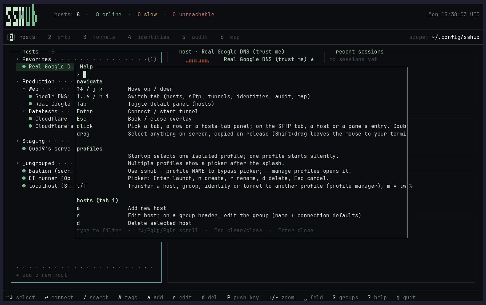

The settings overlay (`Ctrl+H`): the theme, transparency for SSHub's own surfaces or the remote grid, ping, the update check, profiles, OS logos, quit confirmation, the startup animation and session command history:

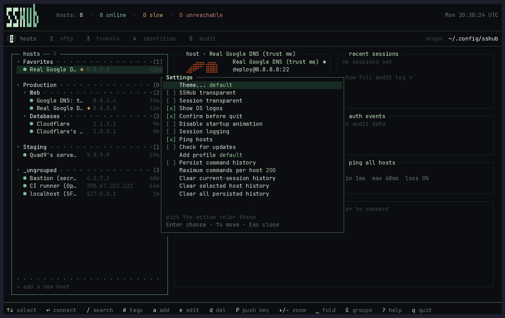

The theme picker, with its detail preview next to the list, and the known hosts manager (`H` on the identities tab):

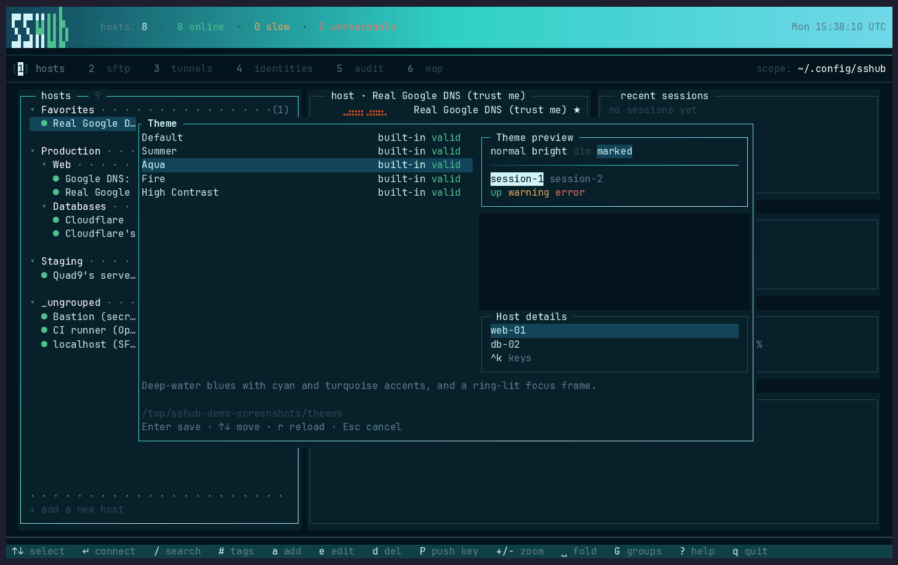
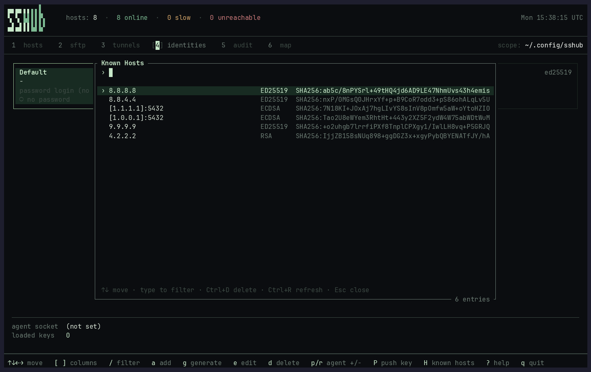

## Features

- **Embedded SSH sessions**: connect opens an in-TUI PTY; detach with `Ctrl+D` and return to the dashboard while SSH keeps running; multiple session tabs, and `Alt+S` switches between open sessions with a searchable picker
- **Interactive SSH authentication**: masked password, passphrase and one-time-code modals. Eligible managed credentials get a remember option that starts clear and is saved only after SSH confirms authentication; generic challenges are never saved. `Enter` submits, `Tab` selects remember, `Space` toggles it, and `Esc` (or `Ctrl+C`) cancels. New host keys require explicit `y` acceptance; changed keys require uppercase `A` to remove the identified stale entry and reconnect for confirmation. Fingerprints are shown unchanged; `PgUp/PgDn` scroll long prompts. A ProxyJump hop that asks for a password is answered with that hop host's own stored secret, never the destination's, and the modal names the hop. OpenSSH may record accepted keys in its configured known_hosts file. Tunnels, headless commands and Mosh keep their existing authentication paths.
- **Share this machine's network**: `Alt+Shift+N` inside an ssh session (or `sshub connect <host> --share-net`) gives the host a SOCKS5 proxy on its own `127.0.0.1` through ssh reverse dynamic forwarding (`-R 127.0.0.1:0`), so a host with no DNS or way out can reach the world through this machine: `apt -o Acquire::http::Proxy=socks5h://127.0.0.1:PORT -o Acquire::https::Proxy=socks5h://127.0.0.1:PORT install ...` or `curl -x socks5h://127.0.0.1:PORT ...`. In the TUI the proxy rides a second ssh connection to the same host that carries nothing else, so the session itself is never touched; the same key stops it, and closing the session or quitting SSHub ends it (on Linux also when SSHub is killed; elsewhere only a SIGKILL can leave it running). It starts once the session is connected. That connection must log in without prompts (a key or a stored password), and a mosh or local shell tab cannot share. It is opt in, never saved on the host, never rides a ControlMaster of yours, and limited to destination ports 80 and 443. The bottom bar shows `⇄ net :PORT` and the host's SSH log gets the ready-to-paste lines; a host that forbids forwarding shows `⇄ net failed` and the session goes on. Security: while it is on, any user on the host can use the proxy to reach whatever this machine reaches on ports 80 and 443, internal web services behind its VPNs included. The local ssh client must know `PermitRemoteOpen` (OpenSSH 8.5); an older one refuses to start with "Bad configuration option".
- **Hosts** — browse, search, and connect. Fuzzy search with `/`, multi-tag AND filter with `#`, favorites, nested groups, manual sort order
- **SFTP file transfer** — a dual-pane browser with a staged transfer queue: navigate both sides, queue uploads and downloads (files or whole folders, transferred recursively), and run them with a progress bar. Files can be staged while the queue runs. Jump straight to a directory by typing its path with `g` (`/home/me`, `../other`, `~/.ssh`; `Tab` completes the last segment). The left pane is your local filesystem by default, or point it at a **second server** with `o` (`O` sends it back to local) to move files between two hosts — relayed through a local temp file, since SSH has no server-to-server copy. Manage files in place too: delete (`d`), new folder (`n`), rename/move (`R`), and change permissions (`M`, octal chmod)
- **OS auto-detection** — on first connect a background probe detects the remote distro and the host card renders its logo (Braille art in brand colors), just like Termius
- **Multiple groups & Favorites** — a host can belong to several groups at once; a reserved Favorites group and a ★ marker in the list, toggled with `f`
- **Tunnels** — define and manage SSH tunnels (local/remote/dynamic SOCKS). Start, stop, and monitor from the TUI. Per-tunnel **keep alive** auto-starts on launch and reconnects dropped forwards with exponential backoff (configurable in `config.toml`).
- **Identities**: key or user+password identities with ssh-agent integration: add (`p`) or remove (`r`) a key from the agent and see its loaded status, generate an ed25519 or rsa-4096 key pair (`g`), push a public key to a host (`Shift+P`), and manage `~/.ssh/known_hosts` (`H`: type to filter, `Ctrl+D` deletes a host's keys, `Ctrl+R` reloads)
- **Group connection defaults**: a group can set a default identity, username, port, ProxyJump, transport and agent forwarding; a host inherits every field it leaves empty. Edit them with `Ctrl+G` (or `e` on a group header) in the TUI, or `sshub group edit --set-default-*` headless
- **Network map** (tab `6`): the jump hosts as a tree, left to right, with every host as a status glyph behind its last hop and a Σ column counting what depends on each hop. Only real jumps are drawn (a host's own ProxyJump, a group default, an ssh_config `ProxyJump`); groups and tags never add an edge. `B` shows a hop's blast radius (and broadcasts to it), `o` the tunnels riding on it, `t` tests the path hop by hop with `ssh -J`, `u` makes a hop the jump of another host, `/` filters (`group:` `tag:` `via:` `!name`). A jump loop is flagged and not connectable; a ProxyCommand shows as an opaque `proxy cmd` hop. `sshub map --dot` prints the same graph for Graphviz. In the host form the ProxyJump field is a hop list with a fuzzy picker (reuse a route, add a host, add a raw hop), a cycle guard, and a per-hop test connect; the stored value is still the plain comma separated ProxyJump string
- **Broadcast** (`b` on the hosts tab): run one command on every managed host in a group or with a tag. Pick the target, type the command, then review the host list in a preview (`e` then `Space` includes or excludes a host, `c` goes back to the command) and press `y` to run. Results land in a docked panel and each host gets an audit row; `x` cancels a running broadcast or clears its error toasts. Your command replaces the host's stored remote command, mosh hosts broadcast over ssh, and output is capped at 1 MiB per host
- **Passwords from KeePassXC** (Linux) - a host's `Secret lookup` field (`sshub host add --secret-lookup`, `host edit --set-secret-lookup`) names one Secret Service entry by an exact attribute match, such as `URL=ssh://root@10.0.0.5:22`, `Title=db-01` or KeePassXC's `Uuid=…`, and its password is used instead of one stored in SSHub. In KeePassXC, enable Secret Service integration and expose the entry's group. The lookup must match exactly one entry, and a jump host never receives it
- **Ad-hoc connect** - in the fuzzy palette (`/`), typing an unknown `[user@]host[:port]` (IPv6 in brackets supported) that matches no saved host offers a "connect without saving" row; Enter opens an embedded ssh session to it. Input is validated and injection-safe (no leading-dash hosts; destination passed after `--`)
- **Local shell tab** - `Ctrl+Shift+T` opens a session tab running your login shell (`$SHELL`, else `/bin/sh`) with the same detach/close semantics as ssh tabs
- **Command snippets** — a library of reusable commands (name, command, optional description and tags). Manage them from the dashboard with `Shift+S` (add/edit/delete); inside a live session `Ctrl+N` opens a fuzzy picker where `Enter` runs the selected command in the PTY and `Tab` inserts it without a trailing newline so you can edit before running
- **Session command suggestions** — as you type in a live session, the rest of a matching
  previously recorded command appears inline as a dim suffix after the cursor. `Tab` (or
  `Ctrl+F`) accepts it, `Esc` dismisses it for that line. Suggestions come from this
  session's in-memory history (always on, last 100 commands), your snippet library, and — only if
  you opt in under Settings (`Ctrl+H`) — a per-managed-host command history stored in the
  owner-only launcher database. Persistence is off by default. Credential filtering and prompt
  detection are best-effort, not a guarantee: unfamiliar secrets may survive, so enable disk
  history only if that risk is acceptable. Flagged commands and multiline pastes are never indexed;
  paste bytes still reach the PTY unchanged. Remote hosts are never probed for suggestions, and
  history stays local-only, outside host sync. Clear history per session, per host or globally
  from Settings. Disabling persistence stops reads and writes but does not delete existing rows.
  Browse and run snippets separately with `Ctrl+N` (`Enter` runs, `Tab` inserts for editing).
  There is no suggestion picker and no `Ctrl+Space` chord.
- **Audit**: log of all connection events with filtering by status (all / ok / fail) and time range (all / 24h / week / month); session connect events record the path to the session log when logging is enabled
- **Session logging** — opt-in capture of PTY session output to `~/.local/share/sshub/profiles/<name>/logs/<host-dir>/` (managed hosts use `{name}-{id}`; pure `~/.ssh/config` aliases without a launcher row may share a directory when sanitized names collide). Enable globally in Settings (`Ctrl+H`) or override per host (`inherit` / `on` / `off`). **Logs capture everything echoed to the terminal, including passwords if they appear on screen.**
- **Session log browser** (`Shift+L`): read those session logs inside the TUI. Pick a host, pick a rotated segment, and view it with terminal escape codes stripped so the transcript reads as plain text. In the viewer, `/` searches (case-insensitive), `n` / `N` step through matches, and `b` bookmarks the current line by name. `m` lists a host's bookmarks to jump straight back to a saved line. Reads are capped so a large transcript is never loaded whole.
- **Mosh transport** — per-host `Transport` field in the host form (`ssh` or `mosh`). Embedded sessions use `mosh` when selected; tunnels and SFTP stay ssh-only.
- **Startup command**: a host's `Startup command` (`--remote-command` headless) runs when you log in, in a remote terminal, and the session goes on in your login shell: `cd /srv/app` starts you in that directory, `cd / && sudo su root` in a root shell in `/` (exit it and you are back in your own shell). Start the command with `exec` to make it the whole session, as in `exec tmux new -A -s main`: the session then ends when it does. This is the ssh transport; an ssh_config host's `RemoteCommand` and a mosh host's command keep their own behaviour
- **Settings overlay** (`Ctrl+H`): pick the theme, let your terminal show through SSHub's own surfaces or through the remote grid (two separate switches, both off by default), toggle OS logos, quit confirmation, the startup animation, session logging, ping probes and the start-up update check, open the profile manager, and control session command history (persist it, the per-host limit of 1 to 2000 commands, and clearing it per session, per host or globally)
- **Headless CLI** — the whole inventory without the TUI: hosts, groups, identities, tunnels, one-shot SFTP, the audit log and themes, plus `sshub exec <host> -- <command>` to run a single command on a saved host and get its output and exit code back (with the stored identity, credential and ProxyJump applied). `--format json` on any listing, stable exit codes, completions for bash/zsh/fish — see [Headless CLI](#headless-cli)
- **Hybrid sources** — hosts from `~/.ssh/config` (read-only) and launcher-managed (full CRUD) merge without duplicates
- **Import/Export**: import from `~/.ssh/config`, Termius backups, PuTTY (a Windows regedit `.reg` export or a Unix `~/.putty/sessions` directory), or mRemoteNG (`confCons.xml`); export managed hosts back to ssh config format (the export stops with an error naming the host if a name, address, user or ProxyJump could not be written safely). Only SSH sessions are imported (RDP/VNC/telnet entries are skipped), and encrypted mRemoteNG passwords are not decrypted (imported hosts carry no stored secret)
- **Hot reload** — edits to `~/.ssh/config` update the host list live via file watcher
- **Configurable keybindings**: rebind any action via `Ctrl+K`; stored in `config.toml` under `[keybinds]`
- **Profiles**: isolated workspaces, each with its own databases, config, themes, logs and keyring namespace (see [Usage](#usage)). In the profile manager (`Alt+P`), `t` transfers a host, group, identity or tunnel to another profile, or `m` after the destination opens an SFTP-style dual-pane screen to stage hosts for pushing (`→`) and pulling (`←`) between the two profiles, followed by their groups, tunnels, identities and audit logs step by step; headless, `sshub host|group|identity|tunnel transfer --to PROFILE` does the same for one entity
- **Update notice** (`Shift+U`): on start SSHub asks GitHub for the latest release, and a newer one shows next to the version in the tab bar. `Shift+U` on the hosts tab installs it the way SSHub was installed (`npm install -g sshub-tui@<version>`, `cargo install sshub --version <version>`, or, for a release tarball, an in-place swap of the binary after checking it runs), then asks you to restart. While it installs, quitting always asks first. With no update known, `Shift+U` checks on demand. Needs `curl` (and `tar` for the tarball swap); `Check for updates` in Settings (`Ctrl+H`), or `[updates] check = false`, turns the start-up check off.
- **What's new** (`Shift+W`): when `Shift+U` finishes an install, a popup shows the changelog of every version it brings (fetched from that release's `CHANGELOG.md`). `Shift+W` on the hosts tab reopens it until the restart, and otherwise shows the running version's notes.
- **Mouse support**: click tabs, rows and hosts-tab panels, scroll lists, double-click to connect, start a tunnel or open an SFTP folder; on the SFTP tab a click picks a host or a pane's entry; in forms, dialogs and pickers a click focuses the field (cursor where you clicked) or highlights the row; a drag anywhere selects text and copies it on release

## Install

From [npm](https://www.npmjs.com/package/sshub-tui), prebuilt, no toolchain required:

```bash
npx sshub-tui              # run it without installing
npm install -g sshub-tui   # then just: sshub
```

The installed command is `sshub`; the package is `sshub-tui` because npm rejects
the bare `sshub` name as too close to the existing `ssh2` and `sshpk`.

Prebuilt for Linux x64, macOS arm64 and macOS x64. The binary arrives as a
platform-specific optional dependency, so nothing is compiled and nothing is
fetched from outside the registry. Any other platform builds from source below.

From [crates.io](https://crates.io/crates/sshub):

```bash
cargo install sshub
```

Requires a Rust toolchain (edition 2021) and `ssh` in `PATH`.

On Linux, building also needs the D-Bus client library for the keyring
(Secret Service) backend that stores host passwords and key passphrases:

```bash
# Debian/Ubuntu
sudo apt-get install -y libdbus-1-dev pkg-config
# Fedora
sudo dnf install -y dbus-devel pkgconf-pkg-config
# Arch
sudo pacman -S --needed dbus
```

Prebuilt binaries for Linux and macOS are attached to each [GitHub release](https://github.com/Petyok/SSHub/releases).

From the [Nix flake](flake.nix) (Linux x86_64 and aarch64), no toolchain required:

```bash
nix run github:Petyok/SSHub               # run it without installing
nix profile install github:Petyok/SSHub   # then just: sshub
```

On NixOS, add it as a flake input, install the package system-wide, and import the
module that points Nix at the prebuilt binaries:

```nix
# flake.nix
inputs.sshub.url = "github:Petyok/SSHub";

# configuration.nix (pass `inputs` to your modules, e.g. via specialArgs)
imports = [ inputs.sshub.nixosModules.binaryCache ];
environment.systemPackages = [
  inputs.sshub.packages.${pkgs.stdenv.hostPlatform.system}.default
];
```

Prebuilt binaries come from the [sshub.cachix.org](https://sshub.cachix.org) cache, so
nothing is compiled. `nixosModules.binaryCache` only sets `nix.settings.substituters` and
`nix.settings.trusted-public-keys`; skip it and set them yourself if you prefer:

```nix
nix.settings.substituters = [ "https://sshub.cachix.org" ];
nix.settings.trusted-public-keys = [
  "sshub.cachix.org-1:yniNe6K3gkRhTgoJL6Rh2Kvqjfaw7ZjTYEFTwIpYjKA="
];
```

For `nix run` and `nix profile install` the flake declares the cache itself, and Nix asks
whether to trust it the first time (answer `y`, or pass `--accept-flake-config`). That
declaration is ignored when the flake is an input of another flake, hence the module. On a
multi-user install a user who is not in `trusted-users` has the flake's cache ignored: add
it to `trusted-substituters` (with the key above in `trusted-public-keys`) or add the user
to `trusted-users`.

The cache holds the build for the nixpkgs this flake pins. Overriding that with
`inputs.sshub.inputs.nixpkgs.follows` changes the store path, so Nix compiles locally,
and an older channel can also fail on an older Rust toolchain. The flake follows the
default branch (`main`), so it tracks releases. The package links nixpkgs' OpenSSL, puts
`openssh` on the end of `PATH` (your own `ssh` still wins), and installs the man page,
icon and desktop entry. Shell completions are not packaged: they embed your host names,
so generate them yourself as described under [Headless CLI](#headless-cli)
(`sshub completions <shell>` works the same for a Nix install).

At runtime, a Secret Service provider (gnome-keyring, KWallet, …) is preferred for secure credential storage. If one is not running or unlocked (e.g. in WSL, Docker, or headless SSH sessions), SSHub will fallback to storing credentials in a local owner-only restricted file (`credentials.json`), notifying you in the status bar.

```bash
git clone https://github.com/Petyok/SSHub.git
cd SSHub
just install    # builds release binary + desktop entry + ~/.local/bin/sshub
```

Or build only:

```bash
just build
cp target/release/sshub ~/.local/bin/
```

## Usage

```bash
sshub              # launch TUI
sshub --version    # print version
sshub --dry-run    # exit immediately (CI / scripts)
sshub --help       # show options
sshub --profile work                     # launch named profile
sshub --manage-profiles                 # open profile picker
```

### Commands

```bash
# Wipe the launcher database — managed hosts, groups, identities, tunnels and
# the audit log. Irreversible, so it refuses unless you confirm. Your
# ~/.ssh/config (and the hosts imported from it) are left untouched.
sshub db purge --yes-i-am-stupid

# Target a profile from the TUI or any headless command.
sshub --profile work host list
sshub --profile personal audit list
sshub --profile work db purge --yes-i-am-stupid
```

SSHUB keeps profile-owned data isolated. Each profile can select its own SSH
config source with `[ssh].config_path`; the default remains shared
`~/.ssh/config`. With one profile, startup remains silent;
with multiple profiles, the picker appears after the splash. From the dashboard,
press `Alt+P` (remappable) or open Settings (`Ctrl+H`) → **Add profile** /
**Manage profiles** to create, rename, delete, or switch workspaces without
restarting SSHub. The footer shows the current profile and shortcut. With one
profile, the action opens creation directly; `Esc` returns to your workspace.
The active profile cannot be renamed or deleted. Switching requires closing SSH
and local shell sessions, disconnecting SFTP and transfers, dismissing broadcasts,
and stopping tunnels (including pending reconnects). A failed load leaves your
current workspace open and displays the error in the manager.

`--profile NAME` bypasses the startup picker. `--manage-profiles` opens it even
when only one profile exists. Press `Esc` in the startup picker to cancel startup.
Headless commands without `--profile` use the last-used profile and never open
the interactive picker.

## Headless CLI

Beyond the TUI, `sshub` exposes a full command-line interface for scripting and
automation: hosts, groups, identities, tunnels, SFTP, and the audit log, no
terminal UI required. `sshub exec <host> -- <command>` runs a single command on
a saved host and hands back its output and exit code, so a script gets the
stored identity, credential and ProxyJump without rebuilding the ssh command
line by hand. Add `--format json` to any listing or show command for
machine-readable output (plain text is the default). Exit codes are stable:
`0` success, `1` operational failure, `2` usage or bad flags, and `124` when
`exec --timeout` kills the run (as `timeout(1)` does). Destructive commands
refuse to run without `--yes`.

```bash
# Hosts
sshub list                                  # list hosts (alias for `host list`)
sshub connect prod-web                       # open an SSH session to a host
sshub host show prod-web --format json       # host details as JSON
sshub host search web                        # fuzzy search
sshub host add --name prod-web --address 10.0.0.5 --port 22 \
    --username deploy --group prod --tags web,prod
sshub host delete --name prod-web --yes      # destructive: needs --yes

# Run a command on a host (scripted; exit code is the remote command's)
sshub exec prod-web -- systemctl is-active nginx
sshub exec prod-web -- 'tail -n 200 /var/log/nginx/error.log' > errors.log
echo "$payload" | sshub exec db-01 -- 'psql -f -'
sshub exec prod-web --timeout 30 --format json -- uptime
sshub exec prod-web -- 'ls && uptime'        # quote it: bare `&&` runs locally
sshub exec prod-web --tty -- top             # full-screen commands need a PTY

# Groups and identities
sshub groups                                 # list host groups
sshub group add --name prod
sshub identity add --name work --username alice --private-key ~/.ssh/id_ed25519
sshub identity agent-remove --name work      # ssh-add -d for the identity's key

# Group connection defaults (issue #74): everything under prod/ goes via the
# bastion as deploy. Resolution per field: host value → best default on any
# group the host belongs to (nearest chain wins; ties break toward the deeper
# group, then the primary group's chain) → global default (port 22, ssh,
# forwarding off). Clearing a host field restores inheritance; tags and
# favorites never inherit.
sshub group edit --name prod --set-default-username deploy \
    --set-default-proxy-jump bastion --set-default-port 2222
sshub group edit --name prod --clear-default-port   # drop one default
sshub host edit --name db-01 --clear-port           # re-inherit the group port

# Copy items to another profile (--move deletes the originals afterwards).
# The plan is printed first; without --yes it asks y/N.
sshub host transfer --name prod-web --to work
sshub group transfer --name prod --to work --with-hosts --yes
sshub identity transfer --name deploy --to work --move
sshub tunnel transfer 3 --to work               # id, label or local port

# Tunnels
sshub tunnel list
sshub tunnel create --host prod-web --type local --local-port 8080 \
    --remote-host localhost --remote-port 80
sshub tunnel start 3                          # start detached (by id, label, or port)
sshub tunnel start 3 --foreground             # run in the foreground with keep-alive
sshub tunnel stop 3

# SFTP (one-shot, over a direct host)
sshub sftp ls prod-web /var/log
sshub sftp get prod-web /var/log/app.log ./app.log
sshub sftp put prod-web ./deploy.tar.gz /tmp/deploy.tar.gz
sshub sftp rm prod-web /tmp/deploy.tar.gz --yes

# Themes (see "Theming" below)
sshub theme list
sshub theme show aqua
sshub theme check ~/.config/sshub/themes/mine.toml

# Audit log
sshub audit list --status fail --days 7
sshub audit stats --days 7

# The jump-host map as a Graphviz graph
sshub map --dot | dot -Tsvg -o map.svg

# Host sync between your own devices (end to end encrypted, over ssh); see "Sync (tab 7)"
sshub sync-join laptop                        # enroll with the device at host "laptop": compare the words (or, if it has no screen, approve the admission)
sshub sync-now                                # sync with every ring device that has a known host
sshub sync-now laptop --format json           # one device, by name or id prefix
sshub sync-status                             # (exit 3 while a recovery of the phone is open) ring devices (this one marked), how each was verified, pending changes, credential mode
sshub sync-review                             # every change waiting for review (id, author, reason, field diffs, Red ceremony)
sshub sync-review --approve 3fa9c1            # or --reject; id = unique prefix (6+ hex digits)
sshub sync-review --approve-all --device <id>   # only that device's changes held for being away that touch no address, jump host, command, user or key
sshub sync-review --approve-all               # every waiting change without a ceremony, in one pass (Red changes, share releases and doubtful ones stay)
sshub sync-revoke <device>                    # remove a device (a big change for a full device; needs two computers you control and the paper phrase, see below)
sshub sync-role <device> holder|mirror        # promote or demote (Red)
sshub sync-approve <op-id>                    # second-device vote on a Red change
sshub sync-factor <op-id> --paper|--email-code   # third factor, read without echo
sshub sync-factor-register paper|email [--sender <this device>]   # the emailed code is kept, sealed, only on its sender: register on the device that will mail it
sshub sync-recovery start [--paper] | approve <op-id> | ack <op-id> | cancel <op-id> --factor paper|email | status
sshub sync-mode vault|quorum [--cosigner <device>]   # two steps: the first call proposes the change (Red); run it again once its ceremony completed to re-encrypt the credentials
sshub sync-exemption on|off <device>          # master-phrase exemption (on needs the TUI)
sshub sync-export --window <seconds> --out <path> [--wait <seconds>]   # bulk export (Red, window <= 3600 s, 0600 file)
sshub sync-migrate [--remove-local]           # replicate this profile's saved secrets
sshub sync-heal                               # after a device was replaced or retired: re-seal saved passwords to every current full device (paper phrase typed once)
sshub sync-rekey [--csv FILE|--stdin] [--new-key HOST]...   # after a stolen device: list, or save new secrets (lines host,newpassword) / a new key installed with the current login
sshub sync-replace-terminal <old> [--new <computer>]   # replace a full computer in steps (enroll, promote, remove), the paper typed once
sshub sync-trust-renew [<id>] [--days N]       # list renewable trust sessions, or print the kind 11 renewal request for the phone
sshub sync-import-kit                         # second machine: set up the Vault from the kit and the phrase
sshub sync-phone-enroll [--replace] [--ble]               # enroll the phone as text (--replace: the verified phone is the NEW phone of a handover from the old one, which still works): frames (base64) on stdin and stdout, the four words, then y or n (--ble: the frames also over Bluetooth)
sshub sync-notice <op-id> [--ble]             # the kind 3 notice (base64) of a Red op for the phone (--ble: also handed over Bluetooth)
sshub sync-phone-chain <phone-id> [--ble]   # the kind 5 list of a restored phone's own newest ops, naming this terminal (unsigned sender): the phone needs it from two different terminals
sshub sync-phone-ops [--ble] < ops.txt        # take in the ops the phone copied (kind 5, base64); prints what applied and why the rest was skipped (chain-gap, already-known, invalid) (--ble: from the phone over Bluetooth)
sshub sync-share-request <host> [--wait 120] [--ble]  # prints the host name, its host id and the four binding words (compare them with the phone), the kind 1 challenge, then reads the phone's kind 2 reply on stdin (or over Bluetooth) and opens the credential in this process
sshub sync-cert-request (--group G | --host H...) [--days 30] [--budget 10] [--ble]   # kind 9 trust-session request for the phone
# Exit codes of sync-now: 0 ok, 1 offline/failed, 2 usage, 3 fork detected. Admin verbs: 0 ok, 1 error, 2 usage.
# sync-serve / sync-enroll are what a peer runs over ssh (frames on stdin and stdout); not for interactive use.

# Inventory sync with ~/.ssh/config
sshub import                                  # import hosts from ssh config (--from ssh)
sshub import --from termius ./termius-export  # import a Termius export dir (L00t.csv)
sshub import --from putty                      # import PuTTY sessions (~/.putty/sessions)
sshub import --from putty ./sessions.reg       # or a Windows regedit .reg export
sshub import --from mremoteng ./confCons.xml   # import an mRemoteNG confCons.xml
sshub import --from putty --dry-run             # preview parsed hosts without writing
sshub sync                                    # refresh ssh_config rows
sshub export --stdout                         # print an ssh_config snippet

# Shell completions
sshub completions zsh > ~/.zsh/completions/_sshub
sshub completions bash
sshub completions fish
```

Run `sshub <command> --help` for a per-command usage block, or `man sshub`
after `just install` (preview the page without installing with `just man`). See
[openwiki/workflows/cli.md](openwiki/workflows/cli.md) for the full command tree.

Shell completions are installed automatically by `just install` (bash and fish
drop into auto-loaded dirs; zsh gets a sourced line appended to `~/.zshrc`).
Run `just install-completions` to (re)install only the completions, or generate
one yourself with `sshub completions bash|zsh|fish`.

### Data paths

| Resource   | Default path                          |
|------------|---------------------------------------|
| Config     | `~/.local/share/sshub/profiles/<name>/config.toml` |
| Themes     | `~/.local/share/sshub/profiles/<name>/themes/*.toml` |
| Databases  | `~/.local/share/sshub/profiles/<name>/{launcher,metadata}.db` |
| Logs       | `~/.local/share/sshub/profiles/<name>/logs/`       |
| Tunnels    | `~/.local/share/sshub/profiles/<name>/tunnels/`    |
| State      | `~/.local/share/sshub/state.toml`                 |
| Credentials | `~/.local/share/sshub/profiles/<name>/credentials.json` (only when no Secret Service is available) |
| SSH config | `~/.ssh/config`, or the profile's `[ssh] config_path` |

Override via environment variables: `SSHUB_CONFIG_DIR`, `SSHUB_DATA_DIR`,
`SSHUB_SSH_CONFIG`. Setting `SSHUB_CONFIG_DIR` or `SSHUB_DATA_DIR` selects
compatibility mode, using those directories verbatim and disabling profile
discovery. Legacy `SSH_LAUNCHER_*` variables remain supported.

## Keybindings

Defaults below. Rebind any action with **Ctrl+K** (saved to `config.toml`). Press `?` in-app for the full list.

### Global (dashboard, any tab)

| Key              | Action                          |
|------------------|---------------------------------|
| `1`..`7`, `h` / `i` | Switch tab (hosts/sftp/tunnels/identities/audit/map/sync); `h` is hosts, `i` identities |
| `Esc`            | Back / close overlay            |
| `Ctrl+H`         | Settings (theme, transparency, logging, ping, updates, profiles, command history); fixed, not rebindable |
| `Ctrl+K`         | Keybind editor                  |
| `Alt+P`          | Add / manage profiles (not in compatibility mode) |
| `Shift+L`        | Browse session logs             |
| `Shift+S`        | Manage command snippets         |
| `Ctrl+Shift+T`   | Open a local shell tab          |
| `?`              | Help screen (type to filter)    |
| `q` / `Ctrl+C`   | Quit (asks first unless `confirm_quit` is off; a second `Ctrl+C` forces it) |

### Session (embedded PTY)

| Key                    | Action                              |
|------------------------|-------------------------------------|
| `Ctrl+T`               | New session tab (host picker)         |
| `Ctrl+Shift+T`         | Local shell tab                     |
| `Ctrl+W`               | Close session tab                   |
| `Ctrl+D`               | Detach to dashboard (SSH keeps running) |
| `Ctrl+[` / `Ctrl+]`, `Ctrl+PgUp` / `Ctrl+PgDn` | Previous / next session tab |
| `Ctrl+Shift+F`         | Open SFTP for this host (the session keeps running) |
| `Alt+Shift+N`          | Share this machine's network with the host, or stop sharing (ssh sessions only) |
| `Ctrl+N`               | Run a command snippet (`Enter` runs, `Tab` inserts without a newline) |
| `Tab` / `Ctrl+F`       | Accept the inline command suggestion; `Esc` dismisses it |
| `Esc` / `Ctrl+O`       | While connecting: cancel / show or hide the `ssh -v` debug log |
| `Ctrl+Shift+S`         | Focus session from dashboard        |
| `Alt+S`                | Switch to an open session (searchable) |
| `Alt+V` / `Alt+J`      | Split view: add a pane side by side / below (up to 4 panes) |
| `Alt+O`                | Split view: focus the next pane (or click a pane) |
| `Alt+M`                | Split view: zoom the focused pane   |
| `Alt+K` / `Alt+I`      | Split view: close the focused pane / back to one pane |
| `Alt+E`                | Workspaces: save this layout under a name, reopen or delete one |
| `PgUp`/`PgDn`, wheel   | Scroll session history; both go to the remote app while it holds the alternate screen (tmux, vim, less), where the wheel becomes arrow keys |
| drag                   | Select terminal text, copied on release; `Shift` inverts it when the remote app owns the mouse |

With sessions running in the background, `Ctrl+T`, `Ctrl+W`, the tab-cycling
keys and `Ctrl+Shift+F` also work from every dashboard tab.

`Ctrl+W` closes a session tab, but inside a form it kills the word before the
cursor (`Ctrl+U` kills everything before it): the host, identity and tunnel
forms and the SSH authentication prompt take readline's editing chords.

On the dashboard and in forms, dialogs and pickers the mouse works too:
drag over anything on screen to copy it on release, click a field to focus
it with the cursor where you clicked, and click a picker row to highlight it
(Enter still chooses).
`Ctrl+Y` copies the focused field's exact value (the stored secret on a
password field), with no label or border. Hold `Shift` to hand the mouse to
your terminal for its own selection and middle-click paste.

The wheel inside `tmux` reaches tmux's own scrollback only with
`set -g mouse on`; without it tmux never asks for the mouse, so the notch
arrives as arrow keys, exactly as in a real terminal.

### Hosts (tab 1)

| Key                | Action                    |
|--------------------|---------------------------|
| `j`/`k` or arrows | Navigate                  |
| `Enter`            | Connect to host (on a group header: fold / unfold) |
| `Tab`              | Toggle detail panel       |
| `a`                | Add host                  |
| `e`                | Edit host; on a group header, edit the group |
| `d`                | Delete host               |
| `Shift+D`          | Duplicate host            |
| `f`                | Toggle favorite           |
| `s`                | Cycle sort mode           |
| `Ctrl+↑` / `Ctrl+↓` | Move host up / down (manual sort) |
| `Space`, `←` / `→` | Fold / unfold the selected group |
| `Shift+↑` / `Shift+↓` | Jump to the previous / next group header |
| `Shift+Z`          | Collapse / expand all groups |
| `+` / `-`          | Widen / narrow the hosts column |
| `Alt`+arrows       | Move dashboard panel focus |
| `z` / `Alt+Enter`  | Zoom focused panel (Esc to exit) |
| `c` / `y`          | Clear / copy the SSH log   |
| `/`                | Fuzzy search              |
| `/` + `[user@]host` | Ad-hoc connect (unknown host, no save) |
| `#`                | Filter by tags (AND)      |
| `Shift+G`          | Manage groups (nested)    |
| `Ctrl+G` / `Ctrl+Shift+G` | Edit / delete the selected group |
| `Shift+I`          | Import from ssh config    |
| `Shift+E`          | Export to ssh config      |
| `Shift+T`          | Import from Termius       |
| `Shift+P`          | Push public key to host   |
| `b`                | Broadcast a command to a group or tag |
| `x`                | Cancel a running broadcast / clear its error toasts |
| `Shift+U`          | Install the sshub update, or check for one |
| `Shift+W`          | What's new: release notes of this version or the installed update |
| `A`                | Make the selected host one of your sync devices (once sync is set up) |

### SFTP (tab 2)

| Key                | Action                                              |
|--------------------|-----------------------------------------------------|
| `Enter`            | Connect to host · enter directory (`..` walks up)    |
| `Tab`              | Switch focus between the panes                       |
| `Backspace`        | Up one directory                                     |
| `g`                | Go to a typed path (`Tab` completes)                 |
| `←` / `→`          | Stage the focused pane's selection toward the other  |
| `c` / `u`          | Run the queue / unstage the last transfer            |
| `o` / `O`          | Left pane to a second server / back to local files   |
| `.`                | Show / hide dotfiles in both panes (remembered)      |
| `d`                | Delete (recursive)                                   |
| `n` / `R` / `M`    | New folder / rename / chmod                          |
| `r`                | Refresh both panes                                   |
| `s`                | Open an SSH session to this host                     |
| `/`                | Filter the focused pane                              |
| `Esc`              | Disconnect, back to the picker                       |

### Tunnels (tab 3)

| Key       | Action                           |
|-----------|----------------------------------|
| `/`       | Fuzzy filter (label, host, ports, type; words may match different fields; `Enter` keeps, `Esc` clears) |
| `a`       | Add tunnel                       |
| `e`       | Edit tunnel                      |
| `d`       | Delete tunnel                    |
| `Enter`   | Start / stop / cancel reconnect  |
| `R`       | Reconnect settings (`+`/`-` adjust, `*` resets the row) |
| `x`       | Kill tunnel process              |

### Identities (tab 4)

| Key        | Action                   |
|------------|--------------------------|
| arrows / `l` | Move through the grid  |
| `[` / `]`  | Fewer / more columns (saved) |
| `/`        | Fuzzy filter (name, user, key path; words may match different fields; `Enter` keeps, `Esc` clears) |
| `a`        | Add identity             |
| `e`        | Edit identity            |
| `d`        | Delete identity          |
| `g`        | Generate SSH key pair    |
| `p`        | Add key to agent         |
| `r`        | Remove key from agent    |
| `Shift+P`  | Push public key to host  |
| `H`        | Known hosts manager (type to filter, `Ctrl+D` delete, `Ctrl+R` refresh) |

### Audit (tab 5)

| Key | Action                              |
|-----|--------------------------------------|
| `f` | Cycle filter (all / ok / fail)       |
| `r` | Cycle range (all / 24h / week / month) |

### Map (tab 6)

| Key | Action |
|-----|--------|
| `↑` / `↓`, `←` / `→` | Previous / next row; walk along the row (hop by hop, then its host glyphs) |
| `Enter` | Connect to the hop or host through the normal connect path (a raw hop: ad-hoc; a cluster: open / fold) |
| `e` | Edit the host under the cursor |
| `/`, `#` | Filter (`group:` `tag:` `via:` `!name`, or fuzzy name); tag picker. `Enter` keeps the filter and opens the clusters holding a match, `Esc` clears |
| `B` | Blast radius of the hop; `n` / `N` step through the dependents, `b` broadcasts to them |
| `o`, `x` | Tunnel lens; start / stop the tunnel of the host under the cursor |
| `u` | Use the hop as the jump of another host (`Tab`: replace or append) |
| `t` | Test the path with `ssh -J`, hop by hop, stopping at the first failure (`Esc` cancels). After a failure: `H` known hosts, `P` push a key to the failed hop, `l` its ssh log |
| `y`, `a`, `z` | Copy the `ssh -J` command; save a raw hop as a host; zoom the map (`Esc` unzooms) |
| click | Select a hop or glyph; double-click connects; the wheel moves the cursor |
| `Space`, `Shift+Z` | Fold a cluster / reveal 20 more hops / expand direct-only; fold every cluster |
| `Shift+G`, `H` | Manage groups; known hosts manager (both work any time on the map) |
| `Esc` | Cancel a test, then unzoom, then clear the lens, then the filter |

Under 80x24 the map becomes an outline (one hop per row); under 40x12 it asks for a bigger terminal.

In the host form, the ProxyJump field is the hop editor: `a` add a saved host, `r` a raw hop, `Enter` replace, `d` remove, `Ctrl+↑` / `Ctrl+↓` move, `n` direct (stores `none`, overriding a group jump), `X` clear (inherit), `t` test the chain. ssh_config hosts stay read-only.

### Sync (tab 7)

Sync keeps hosts and credentials identical on your own devices (laptops, a server, a phone as the second factor), end to end encrypted, over plain `ssh`: a sync is `ssh <peer> sshub sync-serve`, with no daemon and no open port. The words used on screen and in this section are defined in [docs/host-sync-glossary.md](docs/host-sync-glossary.md) (full device, view-only copy, the four check words, trust session, short code). Design and threat model: [docs/host-sync-design.md](docs/host-sync-design.md). The phone app and the phone page: [docs/host-sync-android.md](docs/host-sync-android.md) and [docs/host-sync-companion.md](docs/host-sync-companion.md).

**With one computer there is no backup of your host list.** The phone and the paper phrase hold pieces of passwords, not your hosts. Add a second computer, or a view-only copy on a server at a permanent address, before you rely on sync; until then a lost computer is a lost host list.

#### Quick start

Everything below works from the terminal; the phone steps also have CLI verbs (see the sync verbs in the command list above).

1. **Set up a ring.** On the first machine open the Sync tab (`7`). On the hosts tab select a machine that runs sshub and press `t`, or on a blank machine run `sshub sync-join <host>` against one that has a ring. The first run issues a six-word master phrase and a ring secret, asks you to retype two words, and writes the printable kit (keep it offline, never photograph it). The default credential mode is Vault. Remember that this first computer is the only copy of your host list until you add a second device (step 2).
2. **Add a device.** `A` on the hosts tab (or `sshub sync-join <host>` on the new machine). If both ends have a screen, compare the four check words and answer yes only when identical; for a machine reached over plain ssh the words prove nothing and you approve on the SSH host key you verified. A new device starts as a view-only copy (it sees your hosts but holds no piece of any password). Make it a full device with `M`, "Change a device's role" (or `sshub sync-role <device> holder`); that is a big change (see step 4). On a second machine with the Vault kit: `M`, "Import the Vault kit" (or `sshub sync-import-kit`). Sync runs at start (`[sync] auto_sync_on_start`), on `y` in the Sync tab, or with `sshub sync-now`.
3. **Add the phone.** Install the SSHub app on your Android phone, open it and write down the 24 backup words it shows (it asks you to retype two). In the app choose "Connect to a terminal", and on the terminal `M`, "Add my phone" (or `sshub sync-phone-enroll`). Both screens show a QR in five short steps: Terminal code, Phone code, Terminal keys, Compare the words, Finish. In step 4 both show four check words; answer yes only if they are identical. The phone is then proposed as a full device (a big change, see step 4). No camera on the terminal? Each step also has a text form to paste, and with the `bluetooth` build the steps can travel over Bluetooth. The phone page is an alternative to the app (see "The phone companion").
4. **Approve a change.** A change to an address, jump host, remote command, user or key waits in the review list: `R` in the Sync tab (or `sshub sync-review`), then `a` approve or `r` reject. A big change (a new full device, a removed device, a mode change, a new phone, a bulk export) also needs the three approvals: the phone's confirmation, a second device with a person at the keyboard (`a` there, or `sshub sync-approve <change-id>`) and the paper phrase or the emailed code, which come from outside your devices: `p` types the paper phrase, `e` the emailed code (or `sshub sync-factor <change-id> --paper|--email-code`). Every device evaluates the same rule on the same log; an approval round that is not complete in 3 days is dropped. A change id is the first 8 hex digits shown in the review list; any 6 or more digits that identify one change are accepted.

   **Removing a stolen or lost device** (`M`, "Revoke a device", or `sshub sync-revoke <device>`) needs two computers or servers you control, the one you remove included, together with the phone and the paper phrase (with three or more, the other computers also re-share your passwords; with two, the passwords the removed device held a piece of stay on an exposure list until you change them). With fewer, change the passwords of the hosts and remove the device's key from every host's `authorized_keys` by hand.
5. **Unlock a Quorum credential.** `M`, "Switch the credential mode" proposes Quorum (a Red change); when the ceremony completes run it again to re-encrypt the credentials ("Finish the switch to Quorum", or `sshub sync-mode quorum`). After that a connect that needs a credential opens the unlock modal: it shows the phone's challenge as a QR (also sound or Bluetooth in a build with those features), asks full devices with a person at the keyboard to approve on their screen, and accepts the phone's reply (pasted code, camera, microphone). From the CLI the request is written as a share release, synced, and waits up to `SSHUB_UNLOCK_WAIT` seconds (default 120, at most 3600) for a holder to run `sshub sync-review --approve <id>` (the id is printed). `sshub sync-share-request <host>` asks the phone directly. For many hosts use a trust session (`t` in the Sync tab, scope and 7, 30 or 90 days).
6. **Recover a lost phone.** On any other device with a person at the keyboard: `M`, "Recovery of a lost phone", Start (or `sshub sync-recovery start [--paper]`). It needs two other devices with a person at the keyboard or the paper phrase, plus the paper phrase or the emailed code (`sshub sync-factor <change-id>`), then a 7 day wait during which every device shows it; a device other than the requester confirms it (`sshub sync-recovery ack <change-id>`, automatic on devices with a person at the keyboard). The owner of a phone that is not lost cancels it from the phone with nothing else. After the time lock the recovery stays completable for 3 days, then it lapses and must be started again. When it completes, add the new phone as in step 3. `sshub sync-recovery status` and `sshub sync-status` show each recovery's state and what it waits for.

#### Vault and Quorum

**Vault** is the default. Every credential is encrypted under a key derived from a six-word master phrase and a ring secret (a QR on the printed kit), so any machine with the kit and the phrase can open them and no second device is needed. Its strength is the cost of guessing the phrase: a stolen device holds the ciphertext and the ring secret, so the phrase is what remains. **Quorum** splits each credential's key into shares held by your devices, the phone and a paper phrase, and any two open it: nothing on a stolen machine can be guessed, a second share has to come from a holder that agrees (a holder under a trust session, an attended holder approving on its screen, the phone). Switching modes is a Red change.

What sync does not protect against (the design's honest list, word for word):

- **Genesis:** if the first machine is compromised while the ring is created, no scheme detects it.
- **Metadata:** addresses, `proxy_jump`, notes, groups are readable by every ring device. That is what makes sync work. Only credentials are encrypted.
- **Revocation is not retroactive:** a revoked device keeps what it already downloaded; revocation protects the future (reissue), not the past.
- **Revocation is not instant:** it propagates on sync. The window is narrowed by the freshness check before every release, not closed.
- **The trust-certificate window:** an attacker on a trusted machine reaches credentials inside the certificate's scope, bounded by the new-host budget. Over a full term they cover the scope; what bounds them is the scope, what notices them is the visible list of opened hosts.
- **A stolen device in Vault mode:** the machine holds the ciphertext and the ring secret, so the master phrase remains to be guessed: strength by cost, not by impossibility. In Quorum mode there is nothing to guess.
- **A holder in someone else's datacenter:** a VPS holder puts a share of every key on the most exposed machine in the ring. VPS plus any one device is every credential. Allowed, warned about, not defended.
- **Paper plus any one computer:** two shares of two. The recovery phrase is a key to everything, like a wallet seed.
- **The printed kit** (ring secret QR, and in Vault mode the master phrase): it reconstitutes Vault mode without any device of yours. Treat it as the credential store itself, never photograph it.
- **A phone that only ever sees one machine:** a compromised courier can withhold its ops until the phone touches any other device; bounded by the freshness threshold.
- **Checkpoints:** pruning forgets old ops on the devices that prune, not on the revoked device or in backups; a fork hidden below an accepted cut is no longer provable by a pruned peer.
- **A password changed on the server itself**, outside sshub, is not detected.
- **Old wrapped shares after a revocation:** the forward-secure wrap keys of Quorum mode protect against theft after retirement for holders that can rotate. Not covered: a copy of a holder's key file taken before retirement; holders that cannot rotate (the paper phrase, a phone that has not contacted a terminal since the revocation), whose theft still combines with the revoked device's old share; backups and flash storage that keep a deleted key; and a lying contributor, which can make a credential unrecoverable (the password is then re-entered) but cannot disclose one.

#### Keys

| Key | Where | Action |
|-----|-------|--------|
| `7` | anywhere | Open the Sync tab; until you have a group of devices it says how to start or join one |
| `↑` / `↓` | Sync tab | Select a device |
| `y` | Sync tab | Sync now with the selected device (not with this device) |
| `Enter` | Sync tab | On a compromised device: its proof and what to do next. On a behind or stale one: sync first, then (if it is still behind) re-enroll it through its recorded host |
| `R` | Sync tab | Review every change waiting for approval |
| `t` | Sync tab | Start a trust session: which hosts (a group, or hosts marked with Space, at most 64; never everything), how many days (7, 30 or 90), new hosts per day |
| `M` | Sync tab | Manage your devices: overview, trust sessions, revoke a device, roles, credential mode (propose, then finish the switch once the ring agreed), add my phone, paste phone ops, recovery, paper and emailed-code factors, exemption, bulk export, move local secrets into the ring, import the Vault kit |
| `K` | Sync tab | Register the paper phrase: the 24 words are shown, you type three of them back (chosen at random). Required before a switch to Quorum or a third full device; the Sync tab shows a standing line until it is done |
| `A` | Hosts tab | Make the selected host one of your sync devices |
| `A` | Review | Approve, on this device only, every change of the selected change's device that waits only because the device was away and touches no address, jump host, remote command, user or key; `sshub sync-review --approve-all --device <id>` does the same. Anything else stays one by one with its full diff |
| `a` `r` `p` `e` | Review | `a` approve (for a big change: add this device's approval), `r` reject, `p` type the paper phrase (24 words, nothing is shown), `e` type the emailed code, `Esc` close |

All seven sync keys (tab, now, review, trust, manage, paper, and `A` on the hosts tab) are rebindable in the keybind editor. A device that signed two different histories (a fork) takes over the whole screen and names the device; `Esc` closes the alert and the badge stays red. The tab bar shows `⇅N ⏳Nops`, red when a device is compromised.

The Sync tab is titled "Your devices". Its header says the password mode (Vault or Quorum), how many changes wait for approval and whether you can cut off a stolen device ("yes", or "no, add N more computers": the rule is two computers or servers you control and a registered paper phrase). The table lists each device with its kind (full device, view-only copy, phone), its state (in sync, missed some changes, away too long, needs a look, COMPROMISED, removed) and when it was last in sync; `Enter` opens its details, including its id as a QR code (`sshub:dev:1:<16 hex>`) that the phone app can scan. Lines above the table ask for attention: the ring secret is missing ("Press M, then Import the Vault kit"), a switch or export is still to be finished, a big change expires within 24 hours, the phone has not been seen for 7 days (trust sessions stop at 14). On every tab the tab bar shows the most urgent one of: a big change expires in N h, phone not seen for N days, `sync: offline 6d`, `sync: 2 waiting`; `sshub host list` prints a warning on stderr when a big change expires within 24 hours.

`M` is grouped: Your devices (overview), Changes waiting for approval, Devices (remove a device, change what a device may do), Phone (add the phone, take in what the phone signed, show a restored phone's own changes), Passwords (switch to Quorum or back to Vault, import the Vault kit, paper phrase wizard and sheet, emailed code, move saved passwords), Recovery, Advanced (trust sessions, master phrase exemption, export). Entries that do not apply stay listed with "(not now: reason)". Switching back from Quorum to Vault works in the terminal: `M`, Passwords, "Switch back to Vault": pick the co-signing computer, then choose it again once the approvals are in; a dialog gathers a second full device's approval or the phone for each password. Switching back removes no device: devices that already held pieces of a password can still open the copies made before the switch, so change the password on the server if that matters. `sshub sync-mode vault --cosigner <device>` only proposes it. A trust session is set up on one screen ("Let <this computer> open <hosts> without asking, for 30 days, up to 10 new hosts a day"); the phone's answer is read by the camera (build with the `camera` feature), over Bluetooth, or pasted. An export is proposed once and continued by choosing it again after the approvals. Enrolling a server without a screen asks "Is <host> your server?" with its SSH key fingerprint; the four check words appear only when a person sits at the other end. `sshub sync-join` ends by saying to import the Vault kit when the group uses Vault.

#### Starting a ring, joining, unlocking

First run on a machine with no ring: the app issues a six-word master phrase (from the EFF list) and a ring secret, shows the words once, asks you to retype two of them, then writes the printable kit as two separate files at paths you choose: a phrase sheet and a ring secret sheet (the secret as a QR code and as text). Each carries the "do not photograph" warning, is created owner-only and never overwritten; the phrase is kept nowhere else on disk. Your devices then form a group, with this machine as the first member: the master-phrase key is derived (one second or two, 1 GiB of memory), the ring secret goes to the profile's credential store, and this device becomes the group's first member. On a second machine, `M` then "Import the Vault kit" (or `sshub sync-import-kit`) sets up the Vault from the kit and the phrase.

Joining: `A` on the hosts tab or `sshub sync-join <host>`. Enrollment shows four check words. When both ends have a screen you compare them and answer yes only if they are identical (verified by the four check words). When the other end has no terminal (for example `t` enrolls a server over a plain ssh command) the words prove nothing: the dialog says so, and you approve the admission on the strength of the SSH host key you verified for that host (recorded as verified by the SSH host key). Which of the two admitted a device is shown per device on this tab and in `sshub sync-status`. Roles follow membership, not who connected: the side that already has a group invites, a blank side joins, and two different groups are never merged.

A synced credential stays locked until opened: a connect, SFTP, tunnel, broadcast or key push that needs one opens the unlock modal. In Vault mode you type the six words (the CLI asks on the terminal without echo). In Quorum mode the CLI writes a share release, syncs with the attended holders it has a host for and waits up to `SSHUB_UNLOCK_WAIT` seconds (default 120) for one of them to approve it: in its TUI, or with `sshub sync-review --approve <id>` there (the id is printed). The CLI does not try the phone or trust-session paths. In Quorum mode the modal shows, under the host name, the host id (32 hex digits in groups of four, the way the phone draws it) and the challenge's four check words: compare both with the phone's release screen before you approve there. The modal asks holders that may release under a trust session, asks full devices with a person at the keyboard to approve on their screen, and arms the phone: it shows the phone's challenge code and accepts the pasted reply, the 16 character short code or the 24 words, and, in builds with the opt-in `audio`, `camera` and `bluetooth` features, listens for the phone's sound, reads its code, or serves it over Bluetooth by itself while the modal is open (the modal says when a listener is not compiled in or finds no device; with Bluetooth it shows the name to pick in the phone app's (or page's) device list, `SSHub-` and four characters that change every time). A synced identity's key never touches a disk: it lives in a private `ssh-agent` of this process (and in memory for SFTP) until you lock or quit.

While the profile is in a ring, saving a password, a passphrase or an identity's key file (host form, identity form, key generation, the auth prompt's remember choice, `host add --password-stdin`, `identity add`) writes a replicated credential instead of a local keyring entry, and clearing one replicates the clearing. `M` then "Move this machine's saved secrets into the ring" replicates what was saved before.

#### Review and big changes

Review lists every waiting change with why it waits (`tier`, `stale`, `resurrection`, `revoke-conflict`, `unknown-author`) and its fields as `old -> new`; fields that can redirect a connection (address, port, user, proxy jump, remote command, credentials) are marked `!` and drawn in the error colour. `a` approves and applies an ordinary change, `r` rejects it; both act on the store at once.

A **big** change (removing a full device, changing a role, switching the credential mode, issuing a trust session, registering the paper phrase or emailed code, the master-phrase exemption, a bulk export) takes effect only when the three approvals are in the log: the phone's signature, a second full device with a person at the keyboard, and the paper phrase or an emailed code from outside your devices. Review shows which are present and which are missing; with only one full device with a person at the keyboard, the second device is waived and the paper phrase is required. `a` adds this device's approval, `p` and `e` type the paper phrase or the emailed code; a change whose time ran out is rejected. The approving device never approves for the proposer: propose on one device, approve on another.

#### Trust sessions, recovery, paper

`t` on the Sync tab (or `M`, "Trust session") asks the phone to certify that this machine may open a group or host list for a while without asking each time: a looping QR carries the request, the phone's answer is pasted back, and the approval round above completes it. `M` also extends a trust session's daily budget (a second QR) or revokes it. Recovery of a lost phone (start, approve, acknowledge, cancel, status) is under `M` and in `sshub sync-recovery`. The paper phrase is created and shown once, registered only when you type it back exactly, and can be written to one printable sheet (a single owner-only HTML file with the 24 words, the "do not photograph" warning and the sentence that the sheet is the credential store). The emailed code is registered once and shown once.

#### The phone companion

The phone is the second factor: it holds one piece of your saved passwords, approves big changes and releases a password when you ask. The recommended way is the **SSHub app for Android** (a native app; `android/` in this repository, described in [docs/host-sync-android.md](docs/host-sync-android.md)). Quick start step 3 above connects it. It asks the phone's screen lock before every approval, shows plain sentences for what it asks you to approve ("Make laptop-2 a full device ... Asked by laptop-2."), and keeps its key in the Android key store. Back up the 24 words it shows: they are the only way to get the same phone key back after a wipe, a new phone or a change of fingerprints.

On the terminal side, `M` also holds the phone entries: "Add my phone" (connect the phone), "Paste phone ops" (take in the list of changes the phone copies out), "Show a restored phone's own ops" (a phone restored from its 24 words must read its own newest changes from **two different terminals** before it signs again; each list names its terminal). A switch from Vault to Quorum is the same two steps as `sshub sync-mode quorum`: `M`, "Switch the credential mode" proposes it and shows the approval round; once your devices agreed the same entry reads "Finish the switch to Quorum" and re-wraps the credentials (it asks the master phrase, nothing is shown).

**The phone page** (`assets/companion/sshub-companion.html`) is an alternative that needs no app: one self-contained file with the same steps, for a browser on a phone. Its release fingerprint is shown on it and in `assets/companion/FINGERPRINT`; compare it with the one the terminal shows (Sync tab status or `sshub sync-status`) before you trust it. A browser only gives a page the camera and microphone in a secure context, so the page has to be served from `https://` or from `localhost`. To try it from a development machine over USB:

```bash
python3 -m http.server 8443 --bind 127.0.0.1 --directory assets/companion &
adb reverse tcp:8443 tcp:8443
# on the phone: open http://localhost:8443/sshub-companion.html
```

#### Configuration and build options

```toml
[sync]
auto_sync_on_start = true   # one sync round with every device that has a known host when sshub starts
unattended = false          # true on a device nobody sits at (the Hub): it enrolls as unattended, never votes and no checkpoint or Red change waits for it; read at enrollment, so an already enrolled Hub must re-enroll

[sync.notify]               # off until `command` is set; mails a recovery announcement or a third-factor code
command = "/usr/sbin/sendmail -t -i"   # split without a shell; needs -t (recipients from the headers) and -i (a lone "." must not end the body)
to = ["me@example.com"]
from = "sshub@example.com"
```

The mail is sent by `sshub sync-serve` on the device that serves the round (the Hub, in a ring with one); SMTP credentials belong to the sendmail command's own configuration, never to this file. The phone receivers are opt-in cargo features, off in release binaries: `audio` (microphone, FSK burst) needs the ALSA development files on Linux (`libasound2-dev` on Debian and Ubuntu) and CoreAudio on macOS; `camera` (webcam, the phone's reverse QR) needs nothing extra on Linux (V4L2) and uses AVFoundation on macOS; `bluetooth` (Bluetooth Low Energy: the terminal advertises as a GATT peripheral, the phone app connects natively, the phone page with Web Bluetooth in Chrome on Android; contract C20 in `docs/host-sync-contract.md`) needs a running `bluetoothd` and an adapter on Linux (BlueZ over D-Bus, `libdbus-1-dev` to build) and uses CoreBluetooth on macOS (the first use asks for Bluetooth access). It carries the same frames as the QR, no pairing and no trust in the link; iOS browsers have no Web Bluetooth. The developer check is:

```bash
cargo build --features audio,camera,bluetooth
cargo clippy --all-targets --features audio,camera,bluetooth -- -D warnings
cargo run --example media-probe --features audio,camera   # lists the devices and listens briefly
cargo run --example media-probe --features bluetooth -- 120 --ble   # advertises, sends a test frame, prints what the page sends back
```

On a machine with several adapters, `SSHUB_BLE_ADAPTER=hci1` (an adapter name as BlueZ lists it) makes the Bluetooth channel serve on that adapter; without it BlueZ's default adapter is used.

#### Where sync keeps its state

Sync state lives in the profile directory under `sync/`: `device.key` (this device's identity, encrypted; its passphrase is in the credential store) and `peers.json` (which ssh host reaches which device). Both are owner-only files, belong to one profile, and are never copied by profile transfers or the guided migration, which move hosts, groups, identities and tunnels only.

## Theming

SSHub's colours live in TOML theme files you can copy, edit and switch at
runtime. Five themes ship built into the binary — **`default`**, **`summer`**,
**`aqua`**, **`fire`** and **`high-contrast`** — and your own go in the
selected profile's `themes/*.toml` directory (or `~/.config/sshub/themes/` in
compatibility mode), where the file name is the theme's ID.

```bash
mkdir -p ~/.local/share/sshub/profiles/<name>/themes
sshub theme show aqua > ~/.local/share/sshub/profiles/<name>/themes/mine.toml
$EDITOR ~/.local/share/sshub/profiles/<name>/themes/mine.toml
sshub theme check ~/.local/share/sshub/profiles/<name>/themes/mine.toml
```

Select it in the TUI with **Ctrl+H → Theme… → Enter**: moving through the list
previews each theme on the whole interface, `Esc` rolls back, and `Enter` saves
`appearance.active_theme` to `config.toml`. Nothing else is written.

A theme sets any of three layers — your own `[palette]`, the fixed 25-slot
`[semantic]` core, and per-role `[components]` overrides — plus named static
`[gradients]`. Everything you leave out is inherited from `default`, so
changing one semantic slot recolours everything that uses it. True Color
terminals get the colours as written. The embedded remote session keeps every
colour the remote chose itself; a theme only supplies the ground and the default
foreground the remote left unset.

Three headless commands, all without a TUI or a database:

| Command | What it does |
|---------|--------------|
| `sshub theme list` | Every built-in and user theme with its state |
| `sshub theme show <id> [--resolved]` | The theme's source, or a fully resolved standalone export |
| `sshub theme check <file>` | Strict validation with `file:line:column` diagnostics |

`theme list` and `theme show` read the user themes of the profile `--profile`
names, else the last used one (the config directory in compatibility mode).
`theme check` takes any file path.

**Full guide: [docs/theme-system.md](docs/theme-system.md)** — the file format,
colour values and simulated opacity, inheritance and `"auto"`, gradient
directions and the `perimeter` rule, the complete role catalogue, every picker
key, the CLI exit codes, and two copy-pasteable example themes.

## Configuration

`~/.local/share/sshub/profiles/<name>/config.toml` in profile mode
(`~/.config/sshub/config.toml` in compatibility mode):

```toml
[appearance]
active_theme = "default"    # set by the theme picker (Ctrl+H, Theme...)
transparent_sshub_background = false    # let the terminal show through SSHub's surfaces
transparent_session_background = false  # ...and through the remote session grid
os_logo = true              # distro logo in the host card
confirm_quit = true         # ask before q / Ctrl+C
disable_animation = false   # skip the intro splash and UI motion
identity_columns = 0        # identities grid columns, 0 = auto ([ / ] adjust it)

[session_logging]
enabled = false
max_file_bytes = 10485760   # rotate at 10 MiB
retention_files = 50        # keep newest 50 logs per host

[tunnel_reconnect]
max_attempts = 12           # 0 = unlimited retries
initial_delay_ms = 1000     # 1 s (R overlay edits delays in seconds)
max_delay_ms = 60000        # 60 s
stable_secs = 5             # uptime before a spawn counts as up
jitter_ratio = 0.25

[clipboard]
relay_from_pty = true       # let apps inside a session copy to your clipboard

[ping]
enabled = true              # ICMP status probes (Ctrl+H); hosts override it in their form

[updates]
check = true                # ask GitHub for the latest release on start (Ctrl+H; Shift+U checks on demand)

[command_history]
enabled = false             # persist session commands per managed host (Ctrl+H)
max_entries_per_host = 200  # Settings adjusts it between 1 and 2000

[ssh]
config_path = "~/.ssh/config"   # this profile's ssh_config source (profile mode only; SSHUB_SSH_CONFIG wins)

[sync]
auto_sync_on_start = true       # host sync: one round with known devices at start (see "Sync (tab 7)")
# unattended = true             # a device nobody sits at (the Hub): enrolls as unattended; an already enrolled Hub must re-enroll
# [sync.notify] command = "/usr/sbin/sendmail -t -i" ... mails recovery announcements and codes

[keybinds]
profiles_manage = ["Alt+P"]     # every action is a list of key specs; Ctrl+K edits them
```

## Development

```bash
just build             # release binary
just test              # all tests (unit + smoke + e2e + config)
cargo run -- --dry-run # quick sanity check
```

### Test levels

| Level    | Command                       | What it checks                       |
|----------|-------------------------------|--------------------------------------|
| Unit     | `cargo test`                  | Logic, parsers, fixtures -- no TTY   |
| Smoke    | `cargo test --test smoke`     | Binary starts, `--help`, `--dry-run` |
| E2E      | `cargo test --test e2e`       | TUI scenarios via TestBackend        |
| Config   | `cargo test --test config_load` | Config file creation and loading   |

### Environment variables

| Variable           | Purpose                                    |
|--------------------|--------------------------------------------|
| `SSHUB_CONFIG_DIR` | Override config directory                  |
| `SSHUB_DATA_DIR`   | Override data/SQLite directory             |
| `SSHUB_SSH_CONFIG`  | Override SSH config file path              |
| `SSHUB_DRY_RUN`    | Exit immediately without TUI              |
| `SSHUB_AUTO_QUIT`  | `1` = quit after first draw, `q` = send quit key |
| `SSHUB_VERSION_LABEL` | Replace the tab-bar version label; set but empty hides it (demo recordings) |
| `SSHUB_UNLOCK_WAIT` | Seconds a CLI command (`host connect`, `host resolve`, ...) waits in Quorum mode for a holder to approve its share release (default 120; `0` does not ask) |
| `SSHUB_INSTALL_CHANNEL` | Declare how sshub was installed (`npm`, `cargo`, `source`, ...); picks the `Shift+U` update route and the tab-bar suffix (the npm shim sets `npm`) |

## Tech stack

[Rust](https://www.rust-lang.org/) with [ratatui](https://ratatui.rs/) + [crossterm](https://github.com/crossterm-rs/crossterm) for the TUI, [rusqlite](https://github.com/rusqlite/rusqlite) (bundled SQLite) for storage, [nucleo](https://github.com/helix-editor/nucleo) for fuzzy search, [notify](https://github.com/notify-rs/notify) for file watching. No async runtime -- synchronous event loop with 50ms polling.

## Model credits

Made with dynamic workflows + adversarial-multimodel-reviews + cross-model-reviews. Models with commits, reviews, or blocked merges to their name, in order of appearance:

- Opus 4.8
- Opus 5
- Fable 5
- Composer 2.5
- Grok 4.5
- Qwen 3.8 Max
- GPT-5.6 Luna

## Donations

SSHub is free and AGPL-licensed. If it saves you time, you can throw coins at it:

| Coin | Network            | Address                                      |
|------|--------------------|----------------------------------------------|
| BTC  | Bitcoin (on-chain) | `bc1qvuprwm3r0twn03aej9yv0vjkqj3fkskyq7c3pc` |
| USDT | Tron (TRC20)       | `TRnxCkzKD1Wunhvy1XitCrhLCHNs5U3XRf`         |

Send USDT **only** on the network listed above -- coins sent over another chain
are unrecoverable.

## License

[AGPL-3.0-or-later](LICENSE) — a copyleft license: forks and derivatives must
stay open under the same terms. (Versions ≤ 0.3.1 were released under MIT.)

## Changelog

See [CHANGELOG.md](CHANGELOG.md).
