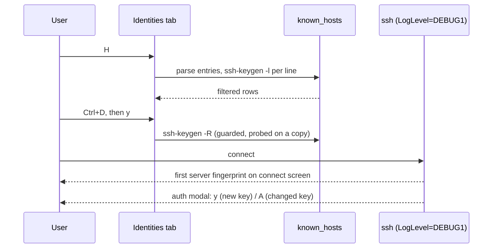

# Known Hosts Manager and Host-Key Verification

On the identities tab (tab 4), `H` (`KeyAction::KnownHosts`) opens the known-hosts manager (`AppMode::KnownHosts`). It reads `~/.ssh/known_hosts` (`known_hosts::known_hosts_path`) and shows the host (or `(hashed)`), an optional `@cert-authority` / `@revoked` marker, the key type, and a `SHA256:` fingerprint computed per line with `ssh-keygen -l -f -` (marker rows get none).

Keys (`App::handle_key_known_hosts`, `src/app/keys.rs`):

- Type to filter on host and fingerprint text; Backspace edits; Up/Down and PageUp/PageDown move.
- `Ctrl+D` (`KeyAction::KnownHostsDelete`) asks for confirmation, then `y`/`Y`/Enter removes **all** keys for that host; any other key cancels.
- `Ctrl+R` (`KeyAction::KnownHostsRefresh`) reloads from disk.
- Esc clears a non-empty filter, otherwise closes.

Both `Ctrl+D` and `Ctrl+R` are remappable in the keybind editor; their defaults only collide with other actions in other modes (session detach, form secret reveal).

Deletion is deliberately narrower than display. `KnownHostEntry::deletion_block_reason` refuses hashed entries, `@cert-authority` / `@revoked` rows, negated (`!host`) patterns and wildcard rows before asking. `known_hosts::remove_host` then refuses a symlinked or non-regular `known_hosts`, and runs `ssh-keygen -R` on a temporary copy first: if the real run would also remove a matching wildcard entry, it refuses instead of changing trust policy as a side effect.

## Connect-time verification

Embedded ssh sessions run with `-o StrictHostKeyChecking=ask` and `LogLevel=DEBUG1` (`prepare_session_connect_argv`), and ssh's own log leaves through a separate `-E` FIFO (see [sessions](sessions-sftp.md)), so only ssh, not a server banner on stderr, can supply evidence. The first `debug1: Server host key:` fingerprint from that log is cached on the session (`host_key_fingerprint_from_log` only accepts a line that starts with that marker, first one wins) and shown on the connect screen.

- **Unknown key**: ssh asks through the askpass channel; the [auth modal](session-tools.md#interactive-authentication-modal) shows the prompt. Only `y` accepts (answers `yes`); `n` or Esc refuses, and Enter does nothing.
- **Changed key**: ssh refuses; `Session::host_key_changed` detects it and the modal shows a warning plus the new fingerprint. Capital `A` removes the stale entry through the same guarded `remove_host` and reconnects; `n`/Esc leaves it alone. The target comes from ssh's own log (`Session::changed_key_target`: the `Host key for <spec> has changed` name and the absolute `Offending … key in <file>:<n>` path) and is used only when the name is one this session connects to (its address, a host argument or `HostKeyAlias`), is a single plain name (no commas or wildcards) and every log line agrees; otherwise no repair is offered.

Other paths keep `accept-new` semantics: `sshub host connect` / `sshub exec` (`prepare_cli_session_argv` / `prepare_cli_connect_argv`), embedded mosh and tunnels add `StrictHostKeyChecking=accept-new` only when a stored secret is staged, [broadcast](broadcast.md) always adds it, and the [SFTP](sessions-sftp.md#sftp-srcsftp) libssh2 transport appends unknown keys itself and treats a changed key as a hard error.

Code: `src/known_hosts.rs`, `src/tui/screens/known_hosts.rs`, `src/app/keys.rs`, `src/app/auth.rs`, `src/session/mod.rs`. Keep `src/app/tests/keybind.rs` and the known-host tests aligned when changing bindings or deletion guards. The [hosts and identities model](../domain/hosts-identities.md) owns host relationships; the per-path [host-key policy](../security/secrets.md#host-key-policy) owns the general trust rules.
